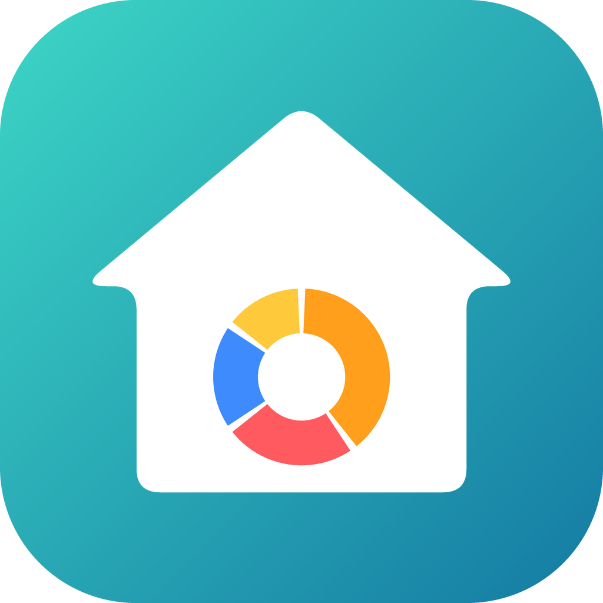

<p align="center">
  
</p>

<h1 align="center">On Budget</h1>

<p align="center">
  <b>La economía de tu casa, clara y en tu bolsillo.</b><br>
  App de presupuesto doméstico libre: sin cuentas, sin anuncios y con tus datos solo en tu móvil.
</p>

<p align="center">
  <a href="https://github.com/AngelFueFer/OnBudget/releases/latest"></a>
  <a href="LICENSE"></a>
  
  
</p>

<p align="center">
  <a href="https://angelfuefer.github.io/OnBudget/">Web</a> ·
  <a href="https://github.com/AngelFueFer/OnBudget/releases/latest/download/presupuesto-familiar.apk">Descargar APK</a> ·
  <a href="https://angelfuefer.github.io/OnBudget/#probar">Probar la beta en Google Play</a> ·
  <a href="https://angelfuefer.github.io/OnBudget/privacidad.html">Privacidad</a> ·
  <a href="CONTRIBUTING.md">Contribuir</a>
</p>

---

## Por qué On Budget

- **Gastos en 3 toques**, con categorías y accesos rápidos.
- **Tus datos son tuyos:** sin registro, sin servidor del desarrollador, sin anuncios ni rastreo. Todo en el dispositivo.
- **Red solo si tú quieres:** banco, cotizaciones y sincronización son opcionales y usan tu propia clave o tu propio servidor.
- **Código abierto (AGPL-3.0):** cualquiera puede comprobar lo que hace la app, y nadie puede cerrar una copia.

## Descargar

| Dónde | Cómo |
|---|---|
| Google Play | En prueba cerrada. [Únete como tester](https://angelfuefer.github.io/OnBudget/#probar). |
| APK directo | [Última versión](https://github.com/AngelFueFer/OnBudget/releases/latest/download/presupuesto-familiar.apk). Permite «instalar apps desconocidas» en Android. |
| Compilar | `flutter pub get && flutter run` (ver [CONTRIBUTING.md](CONTRIBUTING.md)). |

## Funcionalidades

- Registro de ingresos y gastos por categorías, con accesos rápidos.
- Presupuesto mensual repartido entre **Cuenta Mensual** y **Ahorro** (remanente y déficit automáticos).
- Gastos fijos, tarjetas y cuentas de ahorro.
- Importación de extractos bancarios (CSV y Norma 43) y tiquets.
- Detección de pagos a partir de notificaciones de bancos y wallets (Android, opcional).
- Conexión opcional con el banco por Open Banking (PSD2).
- Seguimiento de inversiones y mercados.
- Idiomas (12): español, inglés, francés, alemán, portugués, italiano, neerlandés, polaco, catalán, turco, chino simplificado y japonés. Tema claro/oscuro con color de acento a elegir.
- Sincronización opcional entre dispositivos con tu propio servidor, con los datos cifrados de extremo a extremo
  (en desarrollo). Instalación del servidor: [servidor/README.md](servidor/README.md).

## Comunidad

- ¿Un fallo o tu banco no se detecta? [Abre un issue](https://github.com/AngelFueFer/OnBudget/issues/new/choose).
- ¿Quieres programar o traducir? Lee [CONTRIBUTING.md](CONTRIBUTING.md) y el [código de conducta](CODE_OF_CONDUCT.md).
- ¿Un problema de seguridad? Sigue [SECURITY.md](SECURITY.md), nunca un issue público.
- ¿Te ayuda la app? [Invítame a un café](https://angelfuefer.github.io/OnBudget/#donar).

## Conexión con los bancos (Open Banking / PSD2)

Sirve para **cualquier banco** que cubra el agregador (BBVA, CaixaBank, Abanca, Santander, Sabadell, ING…),
no solo Openbank: el usuario elige su banco y da el permiso en la web de ese banco.

Cada cuenta de **Configuración → Cuentas bancarias** (o **Ahorro → Gestionar cuentas**) se puede
conectar con su banco desde su menú (**Conectar con el banco**). La app descarga el saldo y los
movimientos por PSD2 a través de un agregador con licencia y los muestra en la pantalla de importación
(categoría sugerida y sin duplicados). En las cuentas corrientes los movimientos nuevos vienen ya marcados.

Funciona junto a la lectura de notificaciones (Android): la notificación apunta el gasto al momento y el banco
lo contabiliza 1 a 3 días después. Al sincronizar, un movimiento con el mismo importe y signo que un apunte
existente, con hasta 3 días de diferencia, se marca como «ya importado» aunque el concepto cambie.

Proveedor actual: [Enable Banking](https://enablebanking.com) (gratis para enlazar las cuentas propias).

1. Genera una clave: `openssl genrsa -out private.key 4096` y un certificado
   `openssl req -new -x509 -days 3650 -key private.key -out public.crt`.
2. En [enablebanking.com/cp](https://enablebanking.com/cp) registra una aplicación de **producción**
   con ese certificado y como URL de vuelta `https://angelfuefer.github.io/OnBudget/banco.html` (o la tuya: la página está en `sitio_web/`).
3. Pulsa **Activate by linking accounts** y enlaza tus cuentas (modo restringido, uso personal).
4. En la app: **Configuración → Conexión con los bancos**, pega el *Application ID*, carga `private.key`
   y escribe la misma URL de vuelta.

El permiso del banco dura hasta 180 días (según el banco); después hay que volver a conectar la cuenta.
Para publicar la app para otros usuarios hace falta un contrato con el agregador y un servidor que guarde
la clave privada (no debe ir dentro de la app).

## Estructura

```
lib/
  base_datos/   SQLite (sqflite)
  constants/    colores, textos clave, números
  l10n/         traducciones
  modelos/      entidades de dominio
  pantallas/    UI
  servicios/    lógica (importadores, detectores, APIs; open_banking/ = conexión con bancos)
  utilidades/   IBAN, ISIN, moneda...
assets/branding/  logo de la app
tool/             scripts del proyecto
test/             tests
```

## Logo e identidad

Una casa (economía del hogar) cuya ventana es un gráfico de anillo con el
presupuesto repartido por categorías, sobre un degradado verde.

| Color | Hex |
|---|---|
| Verde claro | `#2BD18E` |
| Verde marca (primary) | `#14A889` |
| Verde oscuro | `#0E8C7F` |
| Acentos | `#FF9F1C` `#FF5A5F` `#3D8BFD` `#FFC93C` |

Archivos en `assets/branding/`: `logo.png` (esquinas redondeadas),
`logo_cuadrado.png` (para tiendas/iOS) y `simbolo.png` (sin fondo).

Para regenerar el logo y **todos** los iconos (Android, iOS, web, macOS, Windows)
tras cambiar colores o formas:

```bash
python tool/generar_logo.py
```

Requiere Python con Pillow (`pip install pillow`).

## Nombre de la app

La app se llama **On Budget** (igual en todos los idiomas). El nombre visible está en:

- Android: `android/app/src/main/res/values/strings.xml` (`app_name`)
- iOS: `ios/Runner/Info.plist` (`CFBundleDisplayName`)
- Dentro de la app: clave `appTitle` en `lib/l10n/traducciones/*.dart`
- Web: `web/manifest.json` y `web/index.html`

Identificador de la app en tiendas: **`app.onbudget`** (Android `applicationId` e iOS Bundle ID). No se cambia nunca más:
Google Play lo fija al subir la app. El paquete Kotlin (`com.example.presupuesto_familiar`) y el nombre del paquete Dart
(`presupuesto_familiar`) son internos y no afectan a la publicación.

## Desarrollo

```bash
flutter pub get
flutter run
flutter test
```

## Descargar el APK

Cada subida a `main` compila el APK y lo publica en **Releases**. Enlace fijo a la última versión:

https://github.com/AngelFueFer/OnBudget/releases/latest/download/presupuesto-familiar.apk

El mismo workflow genera el **AAB** para Google Play (artefacto `on-budget-aab` de la ejecución).

También se puede lanzar a mano en *Actions → APK Android → Run workflow*.

### Firma (recomendado una sola vez)

Sin clave propia el APK se firma con una clave debug distinta en cada build, y Android obliga a
desinstalar (perdiendo los datos) para instalar el siguiente. Para evitarlo:

```bash
keytool -genkey -v -keystore presupuesto.jks -keyalg RSA -keysize 2048 -validity 10000 -alias presupuesto
base64 -w0 presupuesto.jks   # copia la salida
```

En *Settings → Secrets and variables → Actions* crea `ANDROID_KEYSTORE_BASE64`,
`ANDROID_KEYSTORE_PASSWORD`, `ANDROID_KEY_ALIAS` (`presupuesto`) y `ANDROID_KEY_PASSWORD`.
Guarda el `.jks` y las contraseñas fuera del repo: si se pierden, no se podrá actualizar la app.

## Web del proyecto

La web (`sitio_web/`) se publica sola en GitHub Pages al cambiarla en `main` (workflow `web.yml`).
Los datos editables (correo, titular, enlaces de donación y de Google Play) están en `sitio_web/config.js`.
La guía de publicación en Google Play está en `sitio_web/publicar.html`.

## Licencia

[GNU Affero General Public License v3.0](LICENSE). Puedes usar, estudiar, modificar y compartir On Budget; si distribuyes una versión modificada
o la ofreces como servicio en red (por ejemplo, un servidor de sincronización modificado), debes publicar su código con la misma licencia.
